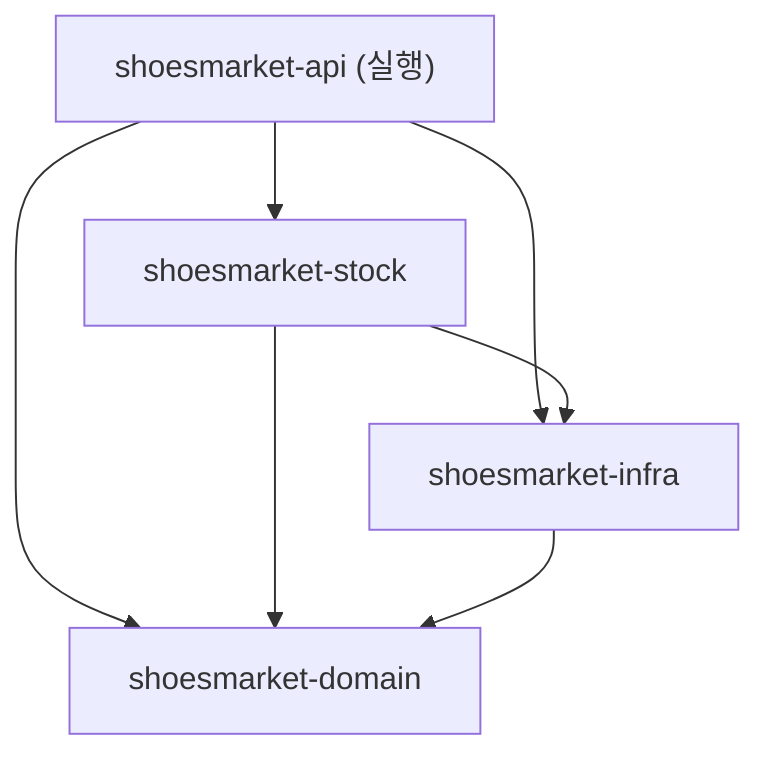
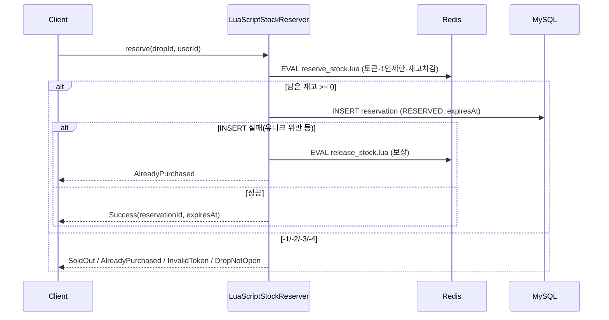

# 👟 ShoesMarket

> 수만 명이 동시에 몰리는 한정판 스니커즈 드롭 상황을 가정한 선착순 구매 시스템

정해진 시각에 한정 수량을 판매할 때 생기는 문제들을 다룹니다.

- **트래픽 제어**: Redis Sorted Set 기반 대기열과 입장 토큰
- **초과판매 방지**: Lua 스크립트로 1인 제한, 재고 확인, 차감을 원자적으로 처리
- **결제 정합성**: 멱등성 키, 선점 만료 처리, PG 대사 배치
- **검증**: k6 부하 테스트로 재고 차감 방식별 성능 비교

> 진행 상황: Phase 1(세팅·도메인·상품/드롭 API) 완료, Phase 2(재고 선점 동시성) 진행 중입니다.
> 아래 문서는 구현이 진행되는 만큼 계속 갱신합니다.

## 기술 스택

| 구분 | 선택 | 왜 이걸 골랐나 |
|---|---|---|
| 언어 | Kotlin 2.2.20 | `value class`로 금액(`Money`)·ID 타입을 값 수준에서 구분해 실수를 컴파일 단계에서 막으려고 |
| 런타임 | Java 21 (toolchain) | LTS. 로컬엔 25도 있지만 Gradle toolchain으로 21을 타깃 |
| 프레임워크 | Spring Boot 3.4 | JPA·트랜잭션·검증·문서화 생태계 |
| 빌드 | Gradle 8.14.3, 멀티모듈 + version catalog | Gradle 9.0은 Kotlin 2.2 플러그인과 증분 컴파일 트랜스폼 충돌이 있어 8.14.3으로 내림 |
| 영속성 | Spring Data JPA + MySQL 8 + Flyway | 스키마는 코드가 아니라 마이그레이션으로 관리(`ddl-auto: validate`) |
| 캐시/큐 | Redis 7 (Lettuce) | 대기열과 재고 선점의 원자 연산 |
| 재고 차감(비교) | Lua / 비관적 락 / 낙관적 락 / Redisson | 방식별 성능·정확성 비교 (Lua가 기본값) |
| 테스트 | Kotest · MockK · 로컬 redis-server · H2 | 단위부터 동시성까지 |
| 린트 | ktlint 1.6.0 | Kotlin 2.2 호환 버전 |

## 아키텍처

실행 모듈은 `api` 하나이고, `domain`은 Spring 의존성이 없는 순수 Kotlin 모듈입니다. 의존은 한 방향으로만 흐릅니다.



| 모듈 | 책임 |
|---|---|
| `domain` | 금액·ID value class, 상태 enum, 결과 sealed interface (Spring/JPA 없음) |
| `infra` | JPA 엔티티·Repository, Flyway, Redis 설정, Lua 스크립트 |
| `stock` | 재고 선점 전략(`StockReserver`)과 구현체 |
| `api` | REST 컨트롤러, 공통 응답·에러, 간이 인증, Swagger |

## 핵심 설계 결정

### 재고 선점을 Redis Lua로 한 이유

초과판매를 막는 핵심은 "재고 확인과 차감, 1인 제한 검사가 하나의 원자 단위여야 한다"는 점입니다. 분산 락(Redisson)으로도 가능하지만, 락을 잡고 푸는 왕복이 경합이 심할수록 비싸집니다. 그래서 기본값은 Lua 스크립트로 정했습니다. 토큰 확인 → 1인 제한(SISMEMBER) → 재고 확인 → DECR + SADD를 한 번의 `EVAL`로 처리해 경합 구간을 Redis 단일 스레드 안에서 끝냅니다.

흐름은 이렇습니다. Lua가 성공(남은 재고 ≥ 0)을 돌려주면 DB에 선점 레코드를 INSERT합니다. 혹시 Redis가 뚫려 같은 유저가 중복으로 들어오더라도, `reservation(drop_id, user_id)` 유니크 제약이 최후 방어선입니다. INSERT가 실패하면 `release_stock.lua`로 Redis 선점을 되돌립니다.



다른 방식(비관적 락, 낙관적 락, Redisson)도 같은 `StockReserver` 인터페이스로 구현해 Phase 6에서 k6로 수치를 비교할 계획입니다.

### 그 밖의 규칙

금액은 `Money(Long)`로만 다루고 `Double`/`BigDecimal`은 쓰지 않습니다. 시간은 `Clock` 빈을 주입받아 테스트에서 고정할 수 있게 했습니다. 엔티티 상태 변경은 세터가 아니라 도메인 메서드(`confirm()`, `expire()` 등)로만 합니다.

## 테스트 전략

동시성은 "말로" 맞다고 할 수 없어서, 실제로 1000명을 동시에 던져 봅니다.

| 테스트 | 막으려는 위험 | 결과 |
|---|---|---|
| 재고 100 / 서로 다른 유저 1000명 동시 선점 | 초과판매 | 정확히 100건 성공, 재고 0, 선점 레코드 100건 |
| 같은 유저 10회 동시 선점 | 1인 제한 우회 | 1건만 성공, 9건 AlreadyPurchased |
| 토큰 없이 선점(검증 ON) | 무단 입장 | InvalidToken |
| 재고 미초기화 드롭 | 오픈 전 선점 | DropNotOpen |

재고 동시성 테스트는 로컬 `redis-server`를 띄워 실제 Lua를 실행하고, 선점 DB는 H2를 씁니다. JPA 매핑은 `@DataJpaTest`(H2)로, 서비스 로직은 MockK로 검증합니다.

## 배치와 정합성 (Phase 5)

`shoesmarket-batch`는 별도 실행 애플리케이션으로, 결제 대사와 재고 정합성을 담당한다.

결제 대사(`PaymentReconciliationService`)는 `READY`로 일정 시간(기본 5분) 멈춘 결제를 PG(토스)에 다시 조회한다. 서버가 PG 승인 직후 DB 반영 전에 죽은 상황을 복구하기 위해서다. PG가 승인(`DONE`)이면 조건부 UPDATE로 선점을 확정하고 주문을 만들어 맞추고, 확정이 불가능하면(이미 만료) PG를 취소한다. PG 미승인 건은 `FAILED`로 닫는다.

재고 정합성(`StockConsistencyService`)은 드롭 종료 후 `total_stock == CONFIRMED + RESERVED + Redis 남은 재고`를 대조해 `consistency_report` 테이블에 기록한다.

### Redis 재시작 시 재고 복구 절차

Redis가 재시작되면 `drop:{id}:stock`과 `buyers`가 사라질 수 있다. DB가 최종 진실의 원천이므로 다음 순서로 복구한다.

1. 드롭을 일시적으로 선점 불가로 둔다(스케줄러가 재초기화하지 않도록 상태 확인).
2. DB에서 해당 드롭의 유효 선점 수를 센다: `CONFIRMED + RESERVED`.
3. 남은 재고를 계산한다: `remaining = total_stock - (CONFIRMED + RESERVED)`.
4. Redis를 복구한다: `SET drop:{id}:stock {remaining}`, `buyers`는 DB의 해당 선점 `user_id`들로 다시 채운다(`SADD`).
5. `StockConsistencyService.check(dropId)`로 대조해 `consistent=true`인지 확인한다.

이 절차 덕분에 Redis를 잃어도 초과판매 없이 재고를 되돌릴 수 있다.

## 실행 방법

```bash
docker compose up -d                 # MySQL 8, Redis 7
./gradlew build                      # 전체 빌드 + 테스트 + ktlint (JDK 21 필요)
./gradlew :shoesmarket-api:bootRun --args='--spring.profiles.active=local'
# Swagger UI: http://localhost:8080/swagger-ui.html
```

- 빌드/실행은 **JDK 21**로 합니다. 로컬 기본이 다른 버전이면 `JAVA_HOME`을 21로 지정하세요.
- 재고 동시성 테스트는 로컬에 `redis-server` 바이너리가 필요합니다(없으면 해당 테스트는 스킵).

## 트러블슈팅

초기 세팅에서 빌드 툴체인 궁합으로 몇 번 막혔습니다. Gradle 9.0 + Kotlin 2.2 플러그인 조합에서 증분 컴파일의 classpath 스냅샷 트랜스폼이 깨졌는데, 원인은 Spring Boot BOM이 `kotlin-*`를 옛 버전(1.9.25)으로 고정해 트랜스폼 클래스패스를 오염시킨 것이었습니다. Gradle을 8.14.3으로 내리고 `extra["kotlin.version"]`으로 BOM의 Kotlin 버전을 덮어써서 해결했습니다. ktlint도 번들된 버전이 Kotlin 2.2 컴파일러와 충돌해 1.6.0으로 올렸습니다.

재고 테스트는 처음에 Testcontainers로 Redis/MySQL을 띄우려 했지만, 로컬 Docker가 29.x로 매우 최신이라 Testcontainers의 docker-java 클라이언트가 API 협상에 실패(400)했습니다. 엔진 자체는 정상이라, 테스트를 로컬 `redis-server` + H2로 바꿔 Docker 의존 없이 동시성 보장을 검증하도록 했습니다.
